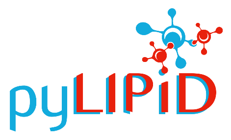

PyLipID - Analysis of Protein–Lipid Interactions from Molecular Dynamics
============================================================

.. image:: https://github.com/pstansfeld/PyLipID/actions/workflows/ci.yml/badge.svg
   :target: https://github.com/pstansfeld/PyLipID/actions/workflows/ci.yml
.. image:: https://img.shields.io/pypi/v/PyLipID
   :target: https://pypi.org/project/pylipid/
.. image:: https://img.shields.io/pypi/pyversions/PyLipID
   :target: https://pypi.org/project/pylipid/

PyLipID is a Python package for analysing lipid–protein interactions from
Molecular Dynamics (MD) simulations. It supports coarse-grained and all-atom
simulations, handles formats supported by MDTraj, and works in scripts or
Jupyter notebooks.

Documentation: https://pylipid.readthedocs.io

Features
========

- Dual-cutoff contact detection to improve coarse-grained accuracy.
- Binding site detection using NetworkX Louvain community analysis.
- Kinetic parameters: koff and residence times per residue and site.
- Interaction metrics including occupancy, count, duration.
- Representative bound pose extraction and clustering.
- SASA calculations per residue and site.
- Publication-ready plots and PyMOL scripts.

Installation
============

From PyPI::

    pip install pylipid

From source::

    git clone https://github.com/pstansfeld/PyLipID
    cd PyLipID
    pip install .

Editable/development install::

    pip install -e .

Requires Python >= 3.11 (tested on 3.11–3.14).

Quick Start
===========

.. code-block:: python

    from pylipid.api import LipidInteraction

    trajfile_list = ["run1/protein_lipids.xtc", "run2/protein_lipids.xtc"]
    topfile_list  = ["run1/protein_lipids.gro", "run2/protein_lipids.gro"]

    li = LipidInteraction(
        trajfile_list,
        topfile_list=topfile_list,
        cutoffs=[0.55, 0.8],
        lipid="CHOL",
        nprot=1,
    )

    li.collect_residue_contacts()
    li.compute_residue_duration()
    li.compute_residue_koff()
    li.compute_binding_nodes(threshold=4)
    li.compute_site_koff()

    li.plot("Residence Time")
    li.save_data("Dataset")
    li.save_pymol_script(pdb_file="receptor.pdb")

PyLipID runs its calculations in parallel worker processes. When running it as a script, put the
code under ``if __name__ == "__main__":`` (required on macOS and Windows, where the script would otherwise
fail or hang); Jupyter notebooks need no change.

What's New in v1.6.0
====================

Bug Fixes
---------
- Corrected binding-site detection off-by-one error.
- Fixed calculate_scores returning None.
- Fixed sparse_corrcoef matrix type issues.
- Fixed DataFrame column/index mismatches in analyze_bound_poses.
- Fixed missing return in compute_residue_lipidcount.
- Fixed a crash when analyze_bound_poses was run more than once with pandas 3.
- cluster_KMeans now always returns labels (it returned a tuple when there were fewer poses than clusters).
- plot, plot_logo, save_coordinate and write_site_info calculate missing residue data on demand instead of raising KeyError.
- Fixed write_PDB errors for .gro files lacking chain IDs.
- Fixed figure overwriting in plot_koff.
- Updated deprecated Matplotlib calls.
- Fixed LogNorm crash on zero-containing matrices.
- Replaced np.float128 with np.longdouble.
- Corrected output directory typo.

Performance
-----------
- collect_residue_contacts computes distances in large batches instead of once per lipid
  (about 1.8x faster than per-residue calls on the test data).
- Survival-function calculation for koff is vectorised (identical results, ~20% faster koff).
- Nested progress bars implemented.

Dependencies
------------
- Removed python-louvain; using NetworkX built-in Louvain.
- Minimum versions added.
- Dropped Python < 3.11; supports Python 3.11–3.14, numpy 2, pandas 3 and current mdtraj.

Packaging & CI
--------------
- Migrated to pyproject.toml.
- CI moved from Travis CI to GitHub Actions.

Citation
========

.. image:: https://img.shields.io/badge/DOI-10.1021/acs.jctc.1c00708-blue
   :target: https://doi.org/10.1021/acs.jctc.1c00708

::

    @article{song_pylipid_2022,
        author  = {Song, Wanling and Corey, Robin A. and Ansell, T. Bertie and
                   Cassidy, C. Keith and Horrell, Michael R. and Duncan, Anna L.
                   and Stansfeld, Phillip J. and Sansom, Mark S.P.},
        title   = {PyLipID: A Python package for analysis of protein-lipid
                   interactions from MD simulations},
        journal = {J. Chem. Theory Comput.},
        year    = {2022},
        doi     = {10.1021/acs.jctc.1c00708},
        url     = {https://doi.org/10.1021/acs.jctc.1c00708},
    }

License
=======

MIT License. See LICENSE.txt.
